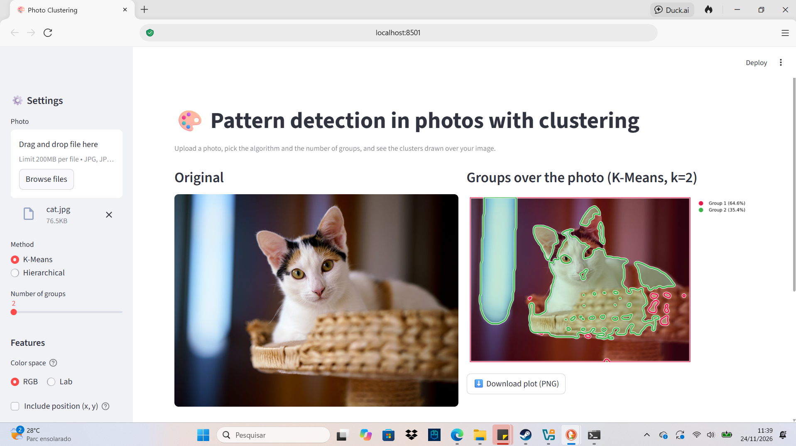

# Image Clustering

Streamlit app that applies cluster analysis to the pixels of a photo and draws the resulting groups over the image.



## Idea

Cluster analysis is a multivariate statistical technique that groups observations by similarity, without labels (Hair et al., 1998). In an image, each pixel is an observation described by its color (RGB or Lab) and, optionally, its position (x, y). Clustering pixels reveals dominant colors and regions, which is useful in computer vision for segmentation and pattern detection.
The broader goal of this project is to evolve an image recognition framework, providing a foundation for identifying visual patterns and grouping similar image elements through statistics techniques.
This repository represents an initial step toward that framework, exploring clustering methods as a foundation for more advanced image analysis capabilities.


## Features

- K-Means or hierarchical clustering (ward, complete, average, single)
- 2 to 15 groups
- RGB or Lab color space, optional pixel position
- Groups drawn as outlines, points or a color mask

## How to use it

```bash
git clone https://github.com/mathblanco/mathblanco.git
cd mathblanco/image-clustering
pip install -r requirements.txt
streamlit run app.py
```

## Reference

Hair, J. F., Tatham, R. L., Anderson, R. E. and Black, W. (1998). *Multivariate Data Analysis* (5th ed.). Prentice Hall.
